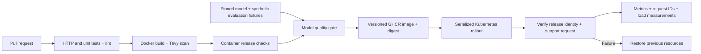

# Fintech Customer Support Copilot

A course project for **Recent areas of artificial intelligence**. It fine-tunes DistilBERT to classify banking support questions, compares it with a TF-IDF baseline, and connects the classifier to a small FAQ and transaction lookup prototype.

The support workflow uses nine authored help entries and 30 synthetic card and transfer records. It does not connect to bank accounts. The benchmark result measures intent classification; the smaller FAQ and workflow checks are reported separately.

## What it does

1. Predicts one of 77 BANKING77 intents with fine-tuned DistilBERT.
2. Retrieves intent-scoped help text with TF-IDF, MiniLM semantic similarity, or hybrid reciprocal-rank fusion.
3. Checks a supplied reference against a local SQLite database for four supported intents. Python validates the intent and reference, and the query is read-only.
4. When a supported reference is present, the app can send a constrained function call through NVIDIA NIM. A second NVIDIA NIM model can draft a reply from retrieved help text.

The Streamlit workbench includes prepared support scenarios, a per-request trace of classification, retrieval, tool routing, and grounding, plus a model scorecard. Hybrid retrieval first gates the FAQ corpus by predicted intent, then combines TF-IDF and MiniLM rankings with reciprocal-rank fusion (RRF, k=60). Its semantic candidate floor of 0.35 is a demo heuristic, not a calibrated relevance threshold. The scorecard measures the active retriever on 22 relevant FAQ queries and four authored out-of-scope queries. It labels confidence and retrieval scores as model signals rather than factuality guarantees, and makes the synthetic-data boundary visible throughout the demo.

Supported lookup intents are `declined_card_payment`, `pending_transfer`, `transfer_not_received_by_recipient`, and `lost_or_stolen_card`. Other BANKING77 intents are classified, but do not have a complete support workflow.

The Streamlit app defaults to the fine-tuned checkpoint at [Hugging Face](https://huggingface.co/nmtan2001/fintech-support-distilbert) and a local extractive response path. If `NVIDIA_API_KEY` is set, the sidebar can enable an NVIDIA-generated answer or an NVIDIA-selected allowlisted function call followed by an answer. The app warns when a mode sends the request to NVIDIA NIM; each function call and reference is still validated in Python before querying SQLite. Without the key, the local demo remains fully usable.

## Results

BANKING77 contains 13,083 English questions across 77 intents. The project uses 9,002 training examples, 1,001 stratified validation examples, and the untouched official test set of 3,080 examples.

| Classifier | Test accuracy | Test Macro-F1 |
| --- | ---: | ---: |
| TF-IDF + Logistic Regression | 85.49% | 85.36% |
| Fine-tuned DistilBERT | 92.44% | 92.44% |

On the official test split, DistilBERT improves accuracy by 6.95 percentage points and Macro-F1 by 7.08 points. The run used seed 42.

TF-IDF reached Recall@1 of 90.9% and Recall@3 of 100% on the 22 relevant FAQ queries, and abstained on all four authored out-of-scope queries. A deterministic workflow check passed 37 of 48 authored cases (77.1%) with the baseline classifier and the LLM disabled. These small checks do not measure live LLM quality or performance on real customer traffic.

## Run the Streamlit app

Use Python 3.10 or later.

```bash
python3 -m venv .venv
source .venv/bin/activate
python -m pip install --upgrade pip
python -m pip install -r requirements.txt
streamlit run app.py
```

The app loads a local model from `outputs/distilbert/model/` when present. Otherwise, it downloads the checkpoint named by `HF_MODEL_ID`, which defaults to the private project checkpoint above; set HF_TOKEN for access. If the DistilBERT dependencies are missing and `outputs/baseline/model.joblib` exists, the app uses the baseline classifier.

TF-IDF remains the default retrieval mode. The Streamlit `requirements.txt` includes Sentence Transformers so the MiniLM semantic and hybrid modes are available in the demo. If installing through project extras instead, use `python -m pip install -e ".[demo,semantic,inference]"`. The MiniLM model downloads from Hugging Face the first time one of those modes is used; question embedding and retrieval then run locally.

Set optional configuration in your environment or in `.streamlit/secrets.toml`:

```toml
HF_MODEL_ID = "nmtan2001/fintech-support-distilbert"
# HF_TOKEN = "your Hugging Face token, if needed"
# HF_MODEL_REVISION = "main"
# NVIDIA_API_KEY = "your NVIDIA API key"
```

Keep API keys out of Git. With no NVIDIA key, intent classification, FAQ retrieval, and the deterministic response still work.

## Run the API

Install the API dependencies in the same environment, then start FastAPI:

```bash
python -m pip install -r requirements.txt -e ".[api]"
export HF_MODEL_ID=nmtan2001/fintech-support-distilbert
uvicorn api:app --reload
```

The API reads `HF_MODEL_ID` from the environment and defaults to the published project checkpoint.
Use `HF_MODEL_REVISION` to select an immutable model commit for repeatable deployments.

The API's three application operations are `POST /support`, `GET /faqs`, and
`GET /demo-status/{reference}`. It also exposes `GET /health` for liveness, `GET /ready` for
model readiness, and `GET /version` for the deployed application version. The support workflow
is `POST /support`:

```bash
curl -X POST http://127.0.0.1:8000/support \
  -H 'Content-Type: application/json' \
  -d '{"question":"Why was my TX-CARD-001 card payment declined?"}'
```

The request can also include `record_reference`, `min_confidence`, `use_llm`, and `llm_select_tool`. NVIDIA calls require `NVIDIA_API_KEY`; set `use_llm` to `true` to generate an answer, and set both `use_llm` and `llm_select_tool` to `true` to ask NVIDIA NIM to select the allowed lookup function.

## Train and evaluate

Download the official dataset and run the baseline:

```bash
python prepare_data.py
python baseline.py
```

Fine-tuning requires a CUDA GPU. The project workflow uses a P100 through `krun`:

```bash
krun run --gpu P100 --requirements requirements-kaggle.txt train.py
```

Run the retrieval and deterministic workflow evaluations with:

```bash
python evaluate_retrieval.py
python evaluate_retrieval.py --backend hybrid
python evaluate_smoke.py --model baseline
```

The test suite uses pytest:

```bash
python -m pip install -r requirements.txt -e ".[api,dev]"
python -m pytest
```

## Project files

- `fintech_support/` contains classification, retrieval, grounding, and read-only lookup code.
- `app.py` runs the Streamlit app; `api.py` defines the FastAPI endpoints.
- `data/faq/demo_policies.json` contains the authored help entries.
- `data/transactions/demo_records.json` contains the synthetic records used to initialize SQLite.
- `data/evaluation/` contains the hand-labeled retrieval and workflow cases.
- `prepare_data.py`, `baseline.py`, and `train.py` prepare data and train the classifiers.
- `outputs/` stores generated models, metrics, and the local SQLite database. It is excluded from Git.

## Data and references

BANKING77 is available from the [PolyAI dataset page](https://huggingface.co/datasets/PolyAI/banking77) under CC BY 4.0. Casanueva et al. introduced the dataset in ["Efficient Intent Detection with Dual Sentence Encoders"](https://aclanthology.org/2020.nlp4convai-1.5/).

The FAQ text and lookup records are project fixtures. They are not policies or account data from a financial institution. The tool only reads the local SQLite database and cannot perform transfers, refunds, or card actions.

## Links

- Code: [github.com/nmtan2001/fintech-support-copilot](https://github.com/nmtan2001/fintech-support-copilot)
- Live app: [Streamlit demo](https://fintech-support-copilot-wrcv8mcbksylppx5oba8dm.streamlit.app)

## DevOps and MLOps delivery

The deployment serves DistilBERT on CPU through FastAPI. Optional NVIDIA answer
and tool selection calls remain external. The private Hugging Face checkpoint
requires a read token in HF_TOKEN. Its exact revision is recorded in
[model-manifest.json](model-manifest.json); production containers use that revision.

The delivery pipeline tests application behavior, scans the image, verifies the
running container, and evaluates the pinned model before publication. Kubernetes
uses the published image digest. Failed rollout or release verification restores
the previous Deployment, ConfigMap and Service when a previous release exists.



Production-oriented controls include two replicas, zero-unavailable rolling
updates, startup/readiness/liveness probes, resource limits, a read-only root
filesystem, non-root execution, hashed dependency locks, pinned action commits,
a namespace-scoped deployer Role, failure diagnostics, and SBOM artifacts.
These controls are implementation details; successful live releases still need
pipeline and cluster evidence.

Use Python 3.11 for the locked runtime and CI environment:

```bash
python3.11 -m venv .venv
source .venv/bin/activate
python -m pip install --require-hashes -r requirements-dev.lock
python -m pip install --no-deps -e ".[api,dev]"
make check
# Export a private-model read token as HF_TOKEN before running the container.
make build
make run
# In another terminal:
make verify
```

The API adds GET /capabilities, GET /metrics and X-Request-ID response headers.
GET /version reports the application commit and configured model revision.
Model confidence remains uncalibrated; monitoring it does not establish accuracy
or prove data drift.

- [Deployment and recovery runbook](docs/operations.md)
- [Release verification](docs/release-verification.md)
- [Monitoring and performance](monitoring/README.md)
- [Assignment evidence checklist](docs/assignment-evidence.md)

Keep original training reports and course submissions as historical artifacts.
The CI/CD assessment needs fresh evidence for v1.0.0, v1.1.0, v1.2.0 and a failed
CI revision; earlier AI-course screenshots are not substitutes.
